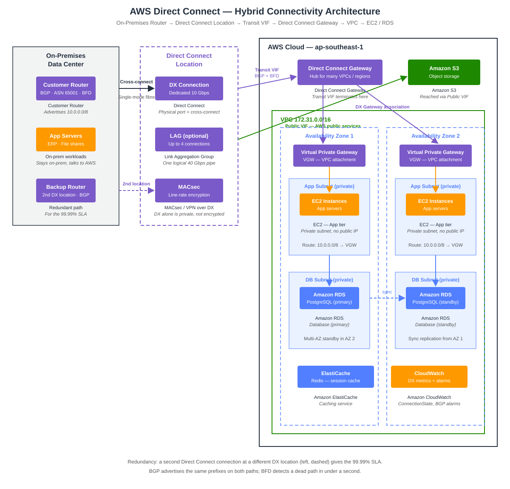

# AWS Direct Connect — A Private Highway to AWS


> **TL;DR** — AWS Direct Connect is a dedicated private network link from your data centre (or office) straight into AWS — no public internet in the path. You get predictable bandwidth, lower and stable latency, and cheaper data transfer out than over the internet. This guide covers the three VIF types, BGP routing, LAGs, the Direct Connect Gateway for multi-VPC designs, and the redundancy setup that earns the 99.99% SLA.

---

## 📐 Architecture



**Traffic flow:** On-premises router → cross-connect at a Direct Connect location → private VIF / transit VIF → Direct Connect Gateway → Virtual Private Gateway → VPC (private subnets) → EC2 / RDS. Public VIF traffic goes to AWS public services (S3, DynamoDB) without touching the internet. BGP advertises routes in both directions; BFD detects a dead path in under a second.

---

## 🌍 In plain words — what is this, really?

Imagine your office sends trucks to a big distribution centre every day, but the public highway is sometimes jammed, sometimes slow, and anyone can see your trucks on it. Direct Connect is like leasing your own private toll road between your office and that centre: the route is fixed, the travel time is predictable, and your traffic does not mix with the public internet at all. Your office is your on-premises data centre, the distribution centre is AWS, and the private road is a dedicated network cable plugged in at a Direct Connect location. Once the road exists, you still need signposts telling traffic which exit leads to which building — that is BGP exchanging routes, and the virtual interfaces (VIFs) are the individual exits to your VPCs or to AWS public services. Companies pay for this road when they move huge amounts of data, need steady low latency, or want a more private and reliable link than a VPN over the public highway. The catch mirrors the analogy too: a private road takes time and money to build, and you still need a backup route in case it closes.

## 🧩 The Pieces, in One Picture

| Piece | What it does | Think of it as |
|---|---|---|
| **Connection** | The physical port at a Direct Connect location: dedicated (1 / 10 / 100 Gbps) or hosted via a partner (50 Mbps – 10 Gbps) | The leased line into the AWS building |
| **LAG** (Link Aggregation Group) | Bundles up to 4 connections at one location into a single logical pipe | Four lanes merged into one wider road |
| **Private VIF** | A virtual interface to **one VPC** via a Virtual Private Gateway | A private driveway to your VPC |
| **Public VIF** | A virtual interface to **AWS public services** (S3, DynamoDB, …) using AWS public IP ranges | A staff entrance to the public AWS services |
| **Transit VIF** | A virtual interface to a **Direct Connect Gateway** — reaches many VPCs, even in other regions | One on-ramp serving the whole highway network |
| **Direct Connect Gateway** | The hub that fans one connection out to many VPCs (same or different regions) | The interchange connecting one road to many cities |
| **BGP** | The routing protocol that exchanges prefixes between your router and AWS (your ASN, MD5 auth, optional BFD) | The two sides agreeing on the map |
| **Virtual Private Gateway (VGW)** | The VPC-side attachment point for a private VIF | The gate on the VPC side of the driveway |

---

## 🆚 Direct Connect vs VPN vs Plain Internet

| | Direct Connect | Site-to-Site VPN | Internet |
|---|---|---|---|
| **Path** | Private, dedicated fibre | Encrypted tunnel over the internet | Public internet |
| **Bandwidth** | Fixed: 50 Mbps – 100 Gbps | Up to ~1.25 Gbps per tunnel | Whatever your ISP gives |
| **Latency** | Low and **stable** | Varies with internet congestion | Varies |
| **Consistency** | Predictable, jitter-free | Good, but internet-dependent | Unpredictable |
| **Encryption** | Not by default — add MACsec or VPN-over-DX | ✅ IPsec by default | TLS per app, if any |
| **Data transfer out** | Cheaper DX rates | Internet rates | Internet rates |
| **Setup time** | Days–weeks (physical cross-connect) | Hours | Minutes |
| **Best for** | Steady high-volume traffic, hybrid cloud, latency-sensitive apps | Quick, cheap, encrypted hybrid link | Everything else |

> 💡 **The classic combo:** run a **VPN over Direct Connect** — you keep the private, predictable DX path *and* get IPsec encryption on top. AWS even supports it natively on a private VIF.

---

## 🔀 Which VIF Do I Need?

```text
One VPC, one region?            →  Private VIF  (+ Virtual Private Gateway)
Many VPCs / several regions?    →  Transit VIF  (+ Direct Connect Gateway)
Need S3 / DynamoDB privately?   →  Public VIF   (announce your public prefixes)
```

| VIF type | Attach to | Reaches | Max per connection |
|---|---|---|---|
| Private | Virtual Private Gateway | 1 VPC | 50 per connection |
| Public | — (AWS public services) | S3, DynamoDB, etc. | 50 per connection |
| Transit | Direct Connect Gateway | Up to 3 DX Gateways per VIF; many VPCs, any region | 4 transit VIFs per DX Gateway |

**Route limits worth knowing:** a DX Gateway accepts up to 100 prefixes from on-premises per gateway (20 by default on some paths — check quotas), and a VGW propagates at most 100 routes. Keep your advertised prefixes summarised; advertising thousands of /32s is how you break BGP.

---

## 🛡️ Resiliency — How to Earn 99.99%

AWS publishes two SLAs. The difference is entirely about redundancy:

| Setup | SLA | What it takes |
|---|---|---|
| Single connection, one DX location | **99.9%** | One dedicated/hosted connection, one VIF |
| Two connections, **two DX locations** | **99.99%** | Redundant connections at different locations, BGP with equal-cost paths, BFD enabled |

Rules that make it real:

1. **Two locations, not two ports in one building.** A fibre cut or a facility outage takes both ports in the same location with it.
2. **BGP on both, advertising the same prefixes.** Traffic fails over automatically when one path dies — no manual route change.
3. **Enable BFD** (Bidirectional Forwarding Detection). BGP alone can take 30–90 s to notice a dead peer; BFD notices in under a second.
4. **Test the failover.** Shut one connection (or ask the DX partner to) during a maintenance window and watch traffic move. An untested redundant path is a rumour.
5. **Mind the MTU:** DX supports jumbo frames up to 9,001 bytes on private VIFs — but your on-prem router, the VGW, and the EC2 instances must all agree, or you get silent fragmentation.

```bash
# See your connections and their state
aws directconnect describe-connections \
  --query 'connections[*].{Id:connectionId, Name:connectionName, State:connectionState, BW:bandwidth, Location:location}'

# Check BGP peer status on a VIF (up / down, and how long it's been up)
aws directconnect describe-virtual-interfaces \
  --query 'virtualInterfaces[*].{Id:virtualInterfaceId, Type:virtualInterfaceType, BGP:BGP Peers[0].bgpStatus}'
```

---

## 💰 Cost — Where the Money Goes

1. **Port hours** — you pay per hour for the connection capacity (dedicated port) or per hour for a hosted connection, whether you use it or not.
2. **Data transfer out** — charged per GB leaving AWS over DX, at a **lower rate** than internet egress. Data transfer *in* is free.
3. **No charge** for the VIFs themselves, the DX Gateway, or BGP sessions.

**The break-even rule of thumb:** if you move a steady, large volume of data out of AWS every month, DX usually pays for itself on the egress discount alone — the private path and stable latency are a bonus. If your traffic is tiny and bursty, a VPN is cheaper.

---

## 💻 Quick Start — Inspect Your Direct Connect Setup

```bash
# 1. List connections, LAGs, and gateways
aws directconnect describe-connections
aws directconnect describe-lags
aws directconnect describe-direct-connect-gateways

# 2. List every VIF and its BGP state
aws directconnect describe-virtual-interfaces

# 3. Check what routes your on-prem router is advertising to AWS
aws directconnect describe-direct-connect-gateway-associations
```

Or run the Python demo — [`direct_connect_demo.py`](direct_connect_demo.py) — for a full offline walkthrough: connection inventory, VIF + BGP health report, a resiliency check against the 99.99% SLA, and a cost estimate for your monthly egress.

---

## 🧠 Common Traps

- **Advertising too many prefixes** — the DX Gateway has route limits; summarise your on-prem networks into a few supernets before advertising.
- **Asymmetric routing** — traffic goes out over DX but replies come back over the VPN/internet (or vice versa). Keep one preferred path per direction, or use BGP AS-path prepending to steer it.
- **No BFD, slow failover** — BGP timers alone mean a minute of black hole on a fibre cut. Enable BFD on both sides.
- **Assuming DX encrypts traffic** — it doesn't. The fibre is private, not encrypted. Add MACsec (on supported dedicated connections) or run a VPN over the VIF for sensitive data.
- **One DX location = one point of failure** — two connections in the same facility share the same fate. 99.99% needs two *locations*.
- **Forgetting the letter of authorisation** — a hosted connection needs a LOA-CFA from AWS before your partner can provision the cross-connect. Budget days for paperwork, not just hours for the CLI.

---

## 📚 Further Reading

- [AWS Direct Connect User Guide](https://docs.aws.amazon.com/directconnect/latest/UserGuide/)
- [Direct Connect resiliency recommendations](https://docs.aws.amazon.com/directconnect/latest/UserGuide/direct-connect-resiliency-recommendation.html)
- [Direct Connect Gateways](https://docs.aws.amazon.com/directconnect/latest/UserGuide/direct-connect-gateways.html)
- [MACsec for Direct Connect](https://docs.aws.amazon.com/directconnect/latest/UserGuide/direct-connect-macsec.html)
